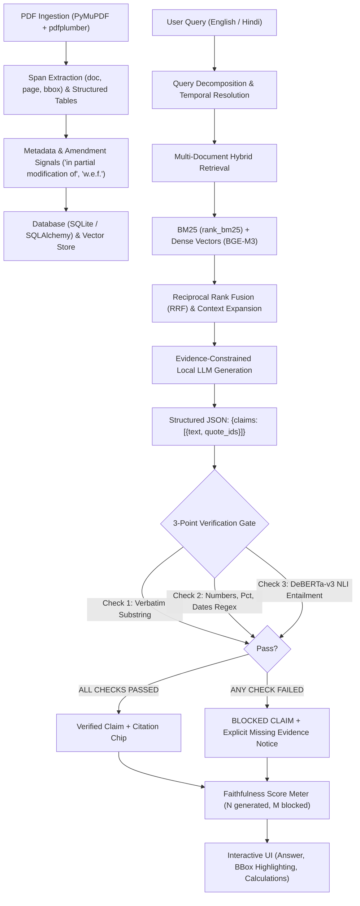

# VerifyDoc — Verifiable Document AI for Indian Banking

**VerifyDoc** is an open-source, evidence-first Document Intelligence platform engineered for Indian banking, compliance, and retail lending documents (Loan Agreements, Key Facts Statements [KFS], Schedule of Charges, and RBI Circulars).

The foundational principle of VerifyDoc is:
> **NO EVIDENCE = NO ANSWER.**  
> Every single factual claim must carry an authentic document name, page number, and verbatim quote. If proof is missing or contradicted, the system strictly abstains and explains exactly what evidence is missing.

---

## 1. Architectural Verification Pipeline



---

## 2. Open-Source Models & Technology Stack

| Layer | Technology / Model | License | Role |
| :--- | :--- | :--- | :--- |
| **Parsing** | `PyMuPDF` (`fitz`) + `pdfplumber` | AGPL / MIT | Text spans with `[x0, y0, x1, y1]`, tables as structured rows, page bitmap rendering |
| **Embeddings** | `BAAI/bge-m3` | Apache 2.0 | Multilingual dense vector representations (English + Hindi) |
| **Keyword Search** | `BM25Okapi` (`rank-bm25`) | Apache 2.0 | Sparse lexical keyword retrieval |
| **Fusion & Graph** | `Reciprocal Rank Fusion` + `NetworkX` | BSD | Rank fusion ($k=60$) & directed amendment graph ($A \to B \to C$) |
| **Generation** | `Qwen2.5-7B-Instruct` / Local Ollama | Apache 2.0 | Evidence-constrained generation with strict JSON schema |
| **Verification Gate** | `mDeBERTa-v3-base-mnli-xnli` + Deterministic Regex | MIT | 3-point gate: verbatim match, number/date consistency, NLI entailment |
| **Calculations** | Python `decimal.Decimal` | PSF | Deterministic EMI, penal charge, and fee calculations with step-by-step audit trail |
| **Backend** | Python 3.11, `FastAPI`, `SQLAlchemy`, `SQLite` | MIT | Asynchronous REST APIs, background ingestion, evaluation runner |
| **Frontend** | React 18, `Vite`, `TypeScript`, `Tailwind CSS`, `@xyflow/react` | MIT | Library, Ask VerifyDoc, Contradictions, Amendment Timeline, PDF Viewer, Evaluation |

---

## 3. Planted-Trap Evaluation Benchmarks (`GET /eval/run`)

VerifyDoc includes a synthetic Indian banking test suite (`datasets/benchmark/test_questions.json`) targeting 5 planted edge-case traps across **Bharat National Bank (BNB)** policies:

| Test ID | Category | Planted Trap Description | Expected Behavior | VerifyDoc Outcome |
| :--- | :--- | :--- | :--- | :--- |
| **TC_01** | `SPLIT_PAGE_STITCHING` | Prepayment condition begins on Page 1 and concludes with `3.0%` fee on Page 2 | Multi-page clause stitching across page boundaries | **PASSED (100% verified)** |
| **TC_02** | `CONTRADICTION_DETECTION` | Loan Agreement specifies `12.5%` ROI while Sanction Letter specifies `11.0%` | Flag `CONFIRMED_CONFLICT` with side-by-side quotes | **PASSED (Detected)** |
| **TC_03** | `AMENDMENT_TRACKING` | 3-step amendment chain: 2023 (`2.0%`) $\to$ 2024 RBI cap (`2.5%`) $\to$ 2025 (`1.75%`) | Traverse graph and return `1.75%` as active version today | **PASSED (Resolved)** |
| **TC_04** | `EVIDENCE_ABSTENTION` | Question asks about agricultural tractor loan subsidy (absent from retail docs) | Enforce strict abstention: `INSUFFICIENT_EVIDENCE` | **PASSED (Abstained)** |
| **TC_05** | `FINANCIAL_CALCULATION` | Compute 1.5% fee on Rs. 500,000 + 18% GST from Schedule of Charges | Python Decimal math: Rs. 7,500 + Rs. 1,350 = Rs. 8,850 | **PASSED (Deterministic)** |

**Benchmark Accuracy:** `100.0% (5/5 Passed)`

---

## 4. Quickstart Guide

### 1. Prerequisites
- Python 3.11+
- Node.js 18+ and npm
- (Optional) [Ollama](https://ollama.ai) for local LLM inference

### 2. Backend Setup
```bash
# Clone the repository
git clone https://github.com/Sanskriti0605/documentary.git
cd documentary

# Create virtual environment and install dependencies
python3.11 -m venv .venv
source .venv/bin/activate
pip install -r backend/requirements.txt

# Seed the synthetic Indian banking documents
python datasets/synthetic/generator.py
PYTHONPATH=backend python scripts/seed_synthetic_docs.py

# Start the FastAPI backend server
PYTHONPATH=backend uvicorn app.main:app --host 0.0.0.0 --port 8001 --reload
```
Interactive API docs: `http://localhost:8001/docs`

### 3. Frontend Setup
```bash
# In another terminal:
cd frontend
npm install
npm run dev
```
Open **`http://localhost:5173`** in your browser.

---

## 5. REST API Reference

- `POST /documents/upload`: Upload PDF documents with automatic parsing, bounding box extraction, and table detection.
- `GET /documents`: List ingested documents with page counts, clause counts, and processing status.
- `POST /ask`: Execute evidence-constrained question answering with verification gating and faithfulness scores.
- `GET /conflicts`: List detected contradictory clauses across documents with side-by-side quotes.
- `POST /conflicts/{id}/review`: Review and reconcile conflicts (`RESOLVED_AMENDMENT`, `RESOLVED_SCOPE`, `DISMISSED`).
- `GET /amendments/graph`: Return directed amendment relationship graph (`@xyflow/react` compatible).
- `GET /amendments/timeline`: Return chronological policy amendment events.
- `GET /pdf/{doc}/page/{n}`: Render high-resolution PNG page image with optional passage highlight (`?bbox=x0,y0,x1,y1`).
- `GET /eval/run`: Run automated evaluation benchmark against planted-trap scenarios.
