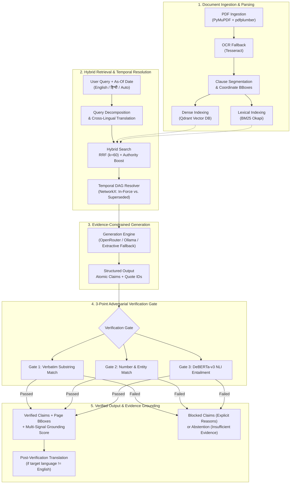

# VERITAS AI — Verifiable Document Intelligence for Banking & Finance

[](https://fastapi.tiangolo.com/)
[](https://react.dev/)
[](https://python.org)
[](https://www.typescriptlang.org/)
[](LICENSE)

> **Core Philosophy:** **NO EVIDENCE = NO ANSWER.**  
> Every generated factual claim must be backed by a verifiable source document reference, page number, pixel-level bounding box, and verbatim quotation. If evidence is missing, outdated, or contradictory, the system explicitly abstains rather than hallucinating.

---

## 📌 Project Overview

**VERITAS AI** is an enterprise-grade, evidence-first document intelligence platform engineered specifically for banking compliance, retail lending policies, and regulatory mandates (such as RBI Master Directions, Circulars, Loan Agreements, and Sanction Letters).

### Key Problems Solved:
1. **The RAG Hallucination Crisis:** Standard LLMs and naive RAG pipelines invent interest rates, misquote clauses, and hallucinate regulatory numbers. In financial compliance, an incorrect penalty fee or rate leads to severe audit failures and legal penalties.
2. **Temporal Blindness:** Regulations evolve constantly through amendments, extensions, and withdrawals. Semantic vector search often retrieves obsolete draft or superseded circulars. VERITAS AI enforces an **As-Of Date Temporal DAG** to resolve active laws at the time of contract execution.
3. **Hidden Contract Contradictions:** Retail lending policies often contain clauses that contradict statutory guidelines (e.g., levying foreclosure fees when prohibited). VERITAS AI flags contradictions across authority tiers.
4. **Black-Box Citations:** Instead of pointing to an entire multi-page PDF, VERITAS AI renders high-resolution page previews with tight, single-color bounding-box highlights over the exact cited quotation.

---

## 🏛️ System Architecture

VERITAS AI replaces black-box LLM generation with a deterministic, multi-stage retrieval, reasoning, and adversarial verification pipeline:



---

## ⚙️ Core Technical Capabilities

### 1. 3-Point Adversarial Verification Gate
Every claim synthesized by the LLM is subjected to independent programmatic verification before reaching the user:
- **Gate 1 (Verbatim Check):** Programmatically verifies that the cited quotation exists verbatim on the source PDF page.
- **Gate 2 (Deterministic Number & Entity Match):** Ensures numbers, interest rates, percentages, and dates in the claim match the source text exactly.
- **Gate 3 (Cross-Encoder NLI Entailment):** Uses `cross-encoder/nli-deberta-v3-small` to compute the direct entailment probability ($P(\text{Entailment}) \ge 0.50$). If not entailed, the claim is blocked.

### 2. Multi-Signal Evidence Grounding & Honest Scoring
Replaces artificial 100% metrics with a multi-signal quality assessment:
- **Generation Pass Rate:** $\frac{\text{Claims Verified}}{\text{Claims Generated}}$ (blocked claims lower the score).
- **Extractive Distinction:** Copied quotes return `grounding: "by_construction"` with null pass rate, avoiding false 100% inflation.
- **Answer Coverage:** Deterministically evaluates required elements (verdict, dates, version chain, numeric units).
- **Retrieval Relevance & Warning:** Detects topic mismatches (e.g. asking for gold loans when only personal loans were retrieved).
- **Confidence Bands:** Derives clear assessment tiers: `HIGH`, `MEDIUM`, `LOW`, or `INSUFFICIENT`.

### 3. Temporal Resolution DAG & Version Lineage
- Directed Acyclic Graph (NetworkX) tracking regulatory circulars, amendments, extensions, and withdrawals.
- Supports **As-Of Date** queries (e.g., *"As of 1 Nov 2024, are foreclosure fees prohibited?"*) to evaluate laws in force at that exact milestone.

### 4. Interactive PDF Evidence Viewer
- High-resolution client-side rendering with coordinate-based bounding-box overlays (`[x0, y0, x1, y1]`).
- Clean rendering by default with single amber (`#f59e0b`) citation highlight.
- **Toolbar Highlight ON/OFF Toggle** (keyboard shortcut: `H`) with Zustand persistence.

### 5. Multilingual & Hindi Question Answering
- Users can query in English, हिन्दी (Devanagari), or Hinglish.
- **Grounded Reasoning:** Retrieval, citation matching, and verification stay strictly in English against original regulatory texts.
- **Post-Verification Translation:** Only the final user explanation is translated; quotes, numbers, and citations remain verbatim in English.

---

## 🛠️ Technology Stack

| Layer | Component / Tool | Details |
| :--- | :--- | :--- |
| **Embeddings** | `BAAI/bge-m3` | 1024-dimensional dense semantic vectors (multilingual) |
| **NLI Verifier** | `cross-encoder/nli-deberta-v3-small` | Neural cross-encoder entailment classifier |
| **Primary LLM** | `nvidia/nemotron-3.5-lightning:free` | Hosted via OpenRouter API (Structured JSON generation) |
| **Local LLM** | `qwen2.5:7b` | Supported via local Ollama instance |
| **Vector DB** | Qdrant | Cosine similarity dense vector index |
| **Lexical Search**| `rank-bm25` (BM25Okapi) | Exact keyword matching & tokenized scoring |
| **PDF & OCR** | PyMuPDF (`fitz`), `pdfplumber`, Tesseract | Text extraction, bounding boxes, table parsing, OCR |
| **Graph Logic** | NetworkX | Regulatory lineage DAG and amendment path traversal |
| **Backend** | FastAPI, SQLAlchemy, aiosqlite | Asynchronous REST API, SQLite storage |
| **Frontend** | React 18, Vite, TypeScript | Modern component architecture, strict type checking |
| **UI & Styling** | Tailwind CSS, Lucide Icons | Responsive styling, accessible components |
| **State & Flow** | Zustand, `@xyflow/react` | Persistent client state, interactive DAG visualization |

---

## 📁 Repository Structure

```
verbatis-ai/
├── backend/
│   ├── app/
│   │   ├── api/routes/          # FastAPI REST endpoints (ask, documents, pdf_viewer, etc.)
│   │   ├── calculations/        # Deterministic financial math (Decimal EMI, penal charges)
│   │   ├── core/                # Configuration and environment settings
│   │   ├── database/            # SQLite models and database initialization
│   │   ├── generation/          # Evidence-constrained LLM engine and prompts
│   │   ├── ingestion/           # PDF parsing, OCR, bounding box alignment, quote matcher
│   │   ├── intelligence/        # Temporal DAG resolver, amendments, multilingual helpers
│   │   ├── providers/           # OpenRouter, Ollama, and Base LLM providers
│   │   ├── retrieval/           # Hybrid retriever (BGE-M3 + BM25 RRF + Qdrant store)
│   │   ├── schemas/             # Pydantic request/response schemas
│   │   └── verification/        # 3-Point Verification Gate & Evidence Scoring engine
│   ├── tests/                   # Backend unit and regression test suite
│   ├── requirements.txt         # Python dependencies
│   └── Dockerfile               # Production container definition
├── frontend/
│   ├── src/
│   │   ├── components/          # Reusable UI components (PdfPageViewer, badges, chips)
│   │   ├── pages/               # Views (EvidenceChat, DocumentLibrary, AmendmentExplorer, etc.)
│   │   ├── services/            # Axios API clients for backend communication
│   │   ├── stores/              # Zustand state management
│   │   └── types/               # TypeScript interfaces and response types
│   ├── package.json             # Frontend dependencies
│   └── vite.config.ts           # Vite dev server and proxy configuration
├── scripts/                     # Seed scripts, bounding-box re-indexing, evaluation runners
├── storage/                     # SQLite database, Qdrant vectors, and document uploads
└── README.md
```

---

## 🚀 Quick Start Guide

### Prerequisites
- **Python**: 3.11+
- **Node.js**: 18+ (with `npm`)
- **Tesseract OCR**: (Optional for scanned image PDFs)
  - macOS: `brew install tesseract`
  - Ubuntu/Debian: `sudo apt-get install tesseract-ocr`
- **OpenRouter API Key**: Free API key from [openrouter.ai](https://openrouter.ai) *(or a local Ollama instance)*

---

### 1. Backend Setup

```bash
# Clone the repository
git clone https://github.com/Sanskriti0605/veritas-ai.git
cd veritas-ai

# Create and activate Python virtual environment
python3 -m venv .venv
source .venv/bin/activate

# Install backend dependencies
pip install -r backend/requirements.txt

# Configure environment variables (.env in project root)
cat <<EOF > .env
LLM_PROVIDER=openrouter
OPENROUTER_API_KEY=your_openrouter_api_key_here
OPENROUTER_MODEL=nvidia/nemotron-3.5-lightning:free
OPENROUTER_BASE_URL=https://openrouter.ai/api/v1
EOF

# Start the FastAPI backend
PYTHONPATH=backend uvicorn app.main:app --host 0.0.0.0 --port 8001 --reload
```

- **Backend API**: `http://localhost:8001`
- **API Documentation**: `http://localhost:8001/docs`
- **Health Check**: `http://localhost:8001/api/v1/health`

---

### 2. Frontend Setup

In a separate terminal:

```bash
cd frontend

# Install dependencies
npm install

# Start Vite development server
npm run dev
```

- **Web Application**: `http://localhost:5173`

---

## 🧪 Testing & Verification

Run the full automated test suite across backend and frontend:

```bash
# Backend verification tests (Evidence Scoring, Clean PDF Render, Hindi QA)
PYTHONPATH=backend .venv/bin/pytest backend/tests/test_evidence_scoring.py backend/tests/test_pdf_clean_render.py backend/tests/test_hindi_end_to_end.py

# Frontend Vitest test suite
npm --prefix frontend test -- --run

# Frontend TypeScript & production build check
npm --prefix frontend run build
```

---

## ⚖️ License & Disclaimer

This project is released under the **Apache 2.0 License**.  
*Disclaimer: This platform is designed for research, compliance auditing, and decision support. It does not constitute formal legal counsel. Always verify critical regulatory determinations against official gazette notifications.*
