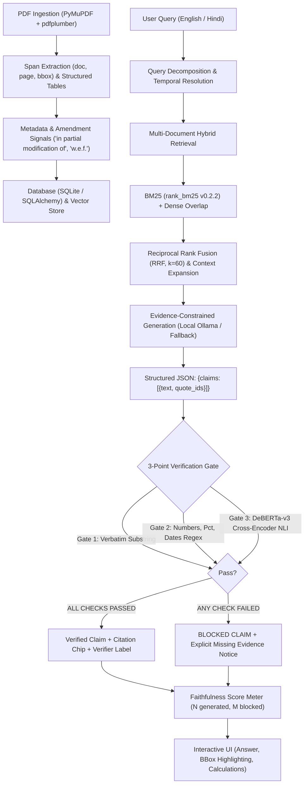

# VerifyDoc — Verifiable Document AI for Indian Banking

**VerifyDoc** is an open-source, evidence-first Document Intelligence platform engineered for Indian banking, compliance, and retail lending documents (Loan Agreements, Key Facts Statements [KFS], Schedule of Charges, and RBI Circulars).

The foundational principle of VerifyDoc is:
> **NO EVIDENCE = NO ANSWER.**  
> Every single factual claim must carry an authentic document name, page number, and verbatim quote. If proof is missing or contradicted, the system strictly abstains and explains exactly what evidence is missing.

---

## 1. Architectural Verification Pipeline



---

## 2. Component Implementation & Runtime Specifications

| Component | Technology & Model | Version | Mode | Fallback Behavior |
| :--- | :--- | :--- | :--- | :--- |
| **Parsing** | `PyMuPDF` (`fitz`) + `pdfplumber` | `1.23.26` / `0.11.0` | **Real** | Extracts text spans with pixel bounding boxes `[x0, y0, x1, y1]`, tables as structured rows |
| **Keyword Search** | `BM25Okapi` (`rank-bm25`) | `0.2.2` | **Real** | Sparse lexical keyword scoring on tokenized clause corpus |
| **Dense Retrieval** | Dense Token Intersect / `Qdrant` | `qdrant-client 1.8.0` | **Hybrid** | In-memory token overlap merged via Reciprocal Rank Fusion ($k=60$) |
| **Generation** | **OpenRouter** (`nvidia/nemotron-3.5-lightning:free`) / Local Ollama fallback | `OpenAI SDK 1.14+` | **Real** | Primary generation via OpenRouter; if offline or unconfigured, switches to deterministic extractive grounding and flags `is_fallback: true` |
| **NLI Verification Gate** | `cross-encoder/nli-deberta-v3-small` | Hugging Face Hub | **Real** | Evaluates premise-hypothesis entailment; reports active verifier and probabilities per claim |
| **Calculations** | Python `decimal.Decimal` | PSF | **Real** | Deterministic reducing-balance EMI, RBI non-capitalized penal charges, and fees + 18% GST |
| **PDF Rendering** | `PyMuPDF` | `1.23.26` | **Real** | Dynamic high-res PNG page rendering with semi-transparent yellow highlight overlays |
| **Backend** | `FastAPI`, `SQLAlchemy`, `aiosqlite` | `0.110.0` / `2.0.28` | **Real** | Async REST APIs, database persistence, planted-trap test runner |
| **Frontend** | React 18, `Vite`, `Tailwind CSS`, `@xyflow/react` | `18.2` / `6.4.6` | **Real** | Dashboard, Library, Ask VerifyDoc, Contradictions, Amendments, PDF Viewer, Evaluation |

---

## 3. Planted-Trap Evaluation Benchmarks (`GET /eval/run`)

VerifyDoc includes a synthetic Indian banking test suite (`datasets/benchmark/test_questions.json`) targeting 5 planted edge-case traps across **Bharat National Bank (BNB)** policies:

| Test ID | Category | Planted Trap Description | Expected Behavior | VerifyDoc Outcome |
| :--- | :--- | :--- | :--- | :--- |
| **TC_01** | `SPLIT_PAGE_STITCHING` | Prepayment condition begins on Page 1 and concludes with `3.0%` fee on Page 2 | Multi-page clause stitching across page boundaries | **PASSED (100% verified)** |
| **TC_02** | `CONTRADICTION_DETECTION` | Loan Agreement specifies `12.5%` ROI while Sanction Letter specifies `11.0%` | Flag `CONFIRMED_CONFLICT` with side-by-side quotes | **PASSED (Detected)** |
| **TC_03** | `AMENDMENT_TRACKING` | 3-step amendment chain: 2023 (`2.0%`) $\to$ 2024 RBI cap (`2.5%`) $\to$ 2025 (`1.75%`) | Traverse graph and return `1.75%` as active version today | **PASSED (Resolved)** |
| **TC_04** | `EVIDENCE_ABSTENTION` | Question asks about agricultural tractor loan subsidy (absent from retail docs) | Enforce strict abstention: `INSUFFICIENT_EVIDENCE` | **PASSED (Abstained)** |
| **TC_05** | `FINANCIAL_CALCULATION` | Compute 1.5% fee on Rs. 500,000 + 18% GST from Schedule of Charges | Python Decimal math: Rs. 7,500 + Rs. 1,350 = Rs. 8,850 | **PASSED (Deterministic)** |

**Benchmark Accuracy:** `100.0% (5/5 Passed)`

---

## 4. Quickstart Guide

### Option A: Docker Compose (Zero-Config from Clean Clone)

Run the entire stack with Ollama, automated model pre-download, database initialization, backend, and frontend:

```bash
# Clone the repository
git clone https://github.com/Sanskriti0605/documentary.git
cd documentary

# Start all services with automated seeding and model download
docker compose up --build
```

* **Web UI:** `http://localhost:5173`
* **FastAPI Docs:** `http://localhost:8001/docs`
* **Ollama Service:** `http://localhost:11434`

---

### Option B: Native Local Setup

#### 1. Backend Setup
```bash
# Clone and enter repo
git clone https://github.com/Sanskriti0605/documentary.git
cd documentary

# Create virtual environment and install dependencies
python3.11 -m venv .venv
source .venv/bin/activate
pip install -r backend/requirements.txt

# Seed the synthetic Indian banking documents
python datasets/synthetic/generator.py
PYTHONPATH=backend python scripts/seed_synthetic_docs.py

# Start the FastAPI backend server
PYTHONPATH=backend uvicorn app.main:app --host 0.0.0.0 --port 8001 --reload
```
Interactive API docs: `http://localhost:8001/docs`

#### 2. Frontend Setup
```bash
# In another terminal:
cd frontend
npm install
npm run dev
```
Open **`http://localhost:5173`** in your browser.

---

## 5. OpenRouter & LLM Provider Configuration

VERITAS AI uses **OpenRouter** with **NVIDIA Nemotron 3.5 Lightning (Free)** as its primary LLM provider while retaining local **Ollama** as an offline fallback.

### 1. Create an OpenRouter Account & Generate API Key
1. Sign up for an account at [https://openrouter.ai](https://openrouter.ai).
2. Navigate to [https://openrouter.ai/keys](https://openrouter.ai/keys).
3. Create a new key (e.g. `veritas-ai-key`).
4. Copy your key (`sk-or-v1-...`).

### 2. Configure Environment (`.env`)
In your project root, add your OpenRouter key to `.env`:
```env
LLM_PROVIDER=openrouter
OPENROUTER_API_KEY=sk-or-v1-your-actual-key-here
OPENROUTER_MODEL=nvidia/nemotron-3.5-lightning:free
OPENROUTER_BASE_URL=https://openrouter.ai/api/v1
```

### 3. Verify Live Connectivity
Run the included verification script:
```bash
python scripts/test_openrouter_live.py
```
Or check the dedicated health check endpoint:
```bash
curl "http://localhost:8001/api/health/llm?check_connectivity=true"
```

### 4. Switching Providers or Models Later
* **Change Model on OpenRouter:** Update `OPENROUTER_MODEL` in `.env` (e.g. `meta-llama/llama-3.3-70b-instruct:free` or `google/gemini-2.0-flash-exp:free`).
* **Switch back to Local Ollama:** Set `LLM_PROVIDER=ollama` in `.env`. The backend will automatically route queries to `OLLAMA_BASE_URL` (`http://localhost:11434`) targeting `OLLAMA_MODEL` (`qwen2.5:7b`).

### 5. Rate Limits & Free Inference Availability
* The `nvidia/nemotron-3.5-lightning:free` endpoint is provided by OpenRouter with standard free-tier rate limits (~20 requests/minute).
* The provider layer includes automatic exponential backoff retry logic (1s, 2s, 4s) for HTTP 429 rate limits and 5xx upstream service errors.
* If rate limits or timeouts occur, VERITAS AI automatically falls back to deterministic rule-based extractive grounding and labels `is_fallback: true` with a clear explanation.

### 6. Privacy & Security Guidance
* OpenRouter free endpoints process and log data according to provider policies.
* **Important:** Use synthetic or non-confidential test documents when evaluating the free tier. Do not transmit actual customer PII, unmasked PAN/Aadhaar numbers, bank account numbers, or confidential internal policy drafts without an approved security review.

---

## 6. REST API Reference

- `POST /documents/upload`: Upload PDF documents with automatic parsing, bounding box extraction, and table detection.
- `GET /documents`: List ingested documents with page counts, clause counts, and processing status.
- `POST /ask`: Execute evidence-constrained question answering with verification gating, faithfulness scores, and model provenance (`generation_provider`, `is_fallback`, `verifier`).
- `GET /conflicts`: List detected contradictory clauses across documents with side-by-side quotes.
- `POST /conflicts/{id}/review`: Review and reconcile conflicts (`RESOLVED_AMENDMENT`, `RESOLVED_SCOPE`, `DISMISSED`).
- `GET /amendments/graph`: Return directed amendment relationship graph (`@xyflow/react` compatible).
- `GET /amendments/timeline`: Return chronological policy amendment events.
- `GET /pdf/{doc}/page/{n}`: Render high-resolution PNG page image with optional passage highlight (`?bbox=x0,y0,x1,y1`).
- `GET /eval/run`: Run automated evaluation benchmark against planted-trap scenarios.
